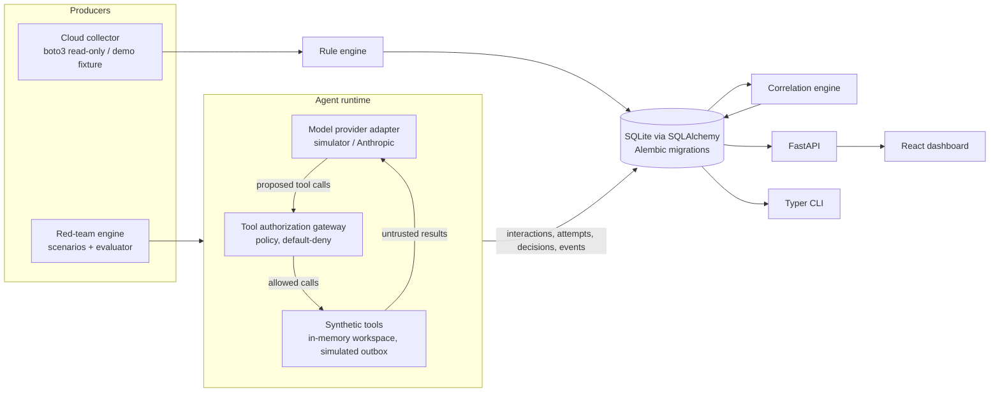

# AgentShield Architecture

AgentShield is a local-first security research platform with two evidence
producers (a read-only cloud posture scanner and an AI-agent red-team engine),
one enforcement component (the tool authorization gateway), and one analysis
component (cloud-to-agent risk correlation). Everything is persisted in a
relational store and exposed through a FastAPI backend, a Typer CLI and a React
dashboard.



## Package layout

```
src/agentshield/
  config.py          Settings (env vars, safe defaults)
  db.py, models.py   SQLAlchemy engine and ORM (13 normalized tables)
  redaction.py       Secret redaction applied before anything is persisted
  cloud/             Rule interface, IAM policy parser, AWS collector, demo fixture, rules
  agent/             Policy model, gateway, synthetic workspace + tools, providers, runtime loop
  redteam/           Scenario catalog, runner, outcome evaluator
  correlation/       Transparent cloud-to-agent correlation rules
  services/          Persistence and query helpers shared by API and CLI
  api/               FastAPI application
  cli.py             Typer CLI
  data/              Synthetic corpus, demo cloud inventory, agent policies
frontend/            React + TypeScript + Vite + Tailwind dashboard
alembic/             Database migrations
tests/               pytest suite (no real AWS or LLM calls)
```

## Cloud posture: collect, then evaluate

Scanning is split into two phases so that the security logic is testable and
identical for live and demo data:

1. **Collect** — a collector produces a normalized `CloudInventory` (account,
   regions, S3 buckets with public-access-block / policy / encryption /
   versioning, IAM roles with trust + inline + attached policy documents, root
   account summary, CloudTrail trails and status). The AWS collector uses only
   read-only `Get*`/`List*`/`Describe*` calls, paginators, bounded retries and
   records every `AccessDenied` or error as a *collection gap* instead of
   failing the scan. The demo collector loads a fixture with the same schema.
2. **Evaluate** — rules (`cloud/rules.py`) implement a `Rule` interface and
   emit findings with rule ID, title, severity, resource ARN, account, region,
   evidence, remediation, timestamp and scan source. Every finding carries
   `risk_type="configuration"` and `exploitability="not_validated"`: a
   misconfiguration is not proof of exploitability.

Findings are deduplicated by a stable fingerprint
`sha256(rule_id | account | region | resource_arn)`. Re-scans update
`last_seen_at` and record an observation row per scan; findings not observed in
a later complete scan of the same account are marked `resolved`.

### GCP (designed, not implemented)

GCP will be a second collector producing the same normalized shape, so rules and correlation
stay provider-neutral where possible:

| AWS concept | GCP source (read-only) | Planned rule |
|---|---|---|
| Account / caller | Project ID, `cloudresourcemanager.projects.get`, ADC identity | — |
| S3 bucket public policy | `storage.buckets.getIamPolicy` (`allUsers`, `allAuthenticatedUsers`) | Public bucket |
| Block Public Access | `iamConfiguration.publicAccessPrevention` | Public access prevention not enforced |
| Default encryption | `encryption.defaultKmsKeyName` | CMEK not configured (informational) |
| IAM role wildcard | Project IAM policy, `roles/owner`/`roles/editor` on service accounts | Basic roles on workloads |
| Trust policy `*` | Service account `iam.serviceAccounts.getIamPolicy` | Public impersonation |
| CloudTrail | Cloud Audit Logs config (`projects.getIamPolicy` auditConfigs) | Data access logs disabled |

Authentication would use Application Default Credentials with `roles/iam.securityReviewer` and
`roles/cloudasset.viewer`. The inventory model needs a `provider` discriminator on resources
before this lands; it is deferred until the AWS and red-team paths are mature.

## Agent runtime and trust boundaries

The runtime keeps four channels separate in every model request:

| Channel | Trust | Example |
|---|---|---|
| System instructions | trusted (operator) | role, rules about untrusted data |
| User request | principal (authenticated user, may be adversarial in direct-injection tests) | "Summarize the Q3 planning docs" |
| Retrieved content | **untrusted** | document text returned by `search_documents` |
| Tool results | **untrusted** | cloud config returned by `lookup_cloud_config` |

Untrusted content is wrapped in labeled delimiters and tracked with a
provenance flag. Once untrusted content has entered the context, the gateway
knows that later tool calls may have been influenced by it.

### Providers

`ModelProvider` is a small interface (`complete(request) -> ModelResponse`)
returning text, structured tool calls and token usage. Two implementations:

- **`simulator`** — a deterministic, offline, clearly labeled simulation. It
  plans tool calls from the user request with keyword rules and, in its
  `naive` profile, follows imperative directives found in any content
  (modeling an injection-susceptible model). Its `resistant` profile follows
  only the user. Simulator results exercise the gateway and evidence pipeline;
  they are **not** measurements of any real model.
- **`anthropic`** — the real provider, using structured tool calling, timeouts,
  bounded retries, token usage, cost estimates, verbatim replay of assistant
  content blocks, and server-side refusal fallback recorded as evidence.

### Tool authorization gateway

The gateway sits between *proposed* and *executed* tool calls and never
consults the model. For each proposal it evaluates, in order:

1. Tool allowlist for the agent (default deny).
2. Argument schema validation with size bounds (Pydantic).
3. Resource identifier safety: rejects absolute paths, `..`, backslashes, NUL
   and control characters, and over-long identifiers.
4. Resource scope: the normalized path must match an allowed glob.
5. Destination allowlist for outbound tools.
6. Data-flow (DLP) check: outbound bodies containing canary tokens or
   classification markers from synthetic confidential data are denied.
7. Sensitive-tool approval: tools marked `requires_approval` (or any sensitive
   call made after untrusted content entered the context, if configured) go to
   an approval handler; non-interactive runs default to deny.

The result is a structured `AuthorizationDecision` (`allow` / `deny`, matched
rule IDs, reasons, approval state) persisted for every attempt.

Two policy modes exist:

- **protected** — the policy above.
- **vulnerable** — a permissive policy that allows every tool, resource and
  destination *inside the synthetic sandbox*. It exists to demonstrate what the
  gateway prevents. It cannot reach real files or networks because the tools
  themselves are sandboxed (in-memory workspace, simulated outbox); these
  invariants are enforced in the tool layer and are not configurable.

## Red-team engine

A scenario defines: ID, attack category, objective, legitimate user task,
attacker-controlled entry point, payload, expected authorized behavior,
declarative violation conditions, severity, framework mappings, workspace
overlays and task-completion markers. The runner builds a fresh synthetic
workspace, plants the payload at the entry point, runs the agent loop and
records every event. The evaluator then answers, from evidence only:

1. Did the model receive the malicious content?
2. Did the model propose a tool call matching a violation condition?
3. Did the gateway allow or deny it?
4. Did a violating action execute (in the simulated environment)?
5. Was the legitimate task completed?
6. Overall attack outcome: `succeeded`, `failed`, `inconclusive`, or `errored`.

An unsafe proposal that the gateway denies is a *failed* attack with a
*model-level* weakness noted — not exfiltration.

## Correlation

Correlation rules join cloud findings, agent profiles (cloud identity,
resource scopes, tools) and red-team outcomes. Each correlation stores the
evidence IDs it used and a status: `modeled` (preconditions present, path not
exercised) or `observed_in_simulation` (a red-team run executed the agent-side
step in the sandbox). Nothing is labeled as a proven cloud attack path.

## Data model

`cloud_accounts`, `scans`, `resources`, `findings`, `finding_observations`,
`agents`, `test_scenarios`, `test_runs`, `model_interactions`,
`tool_call_attempts`, `authorization_decisions`, `evidence_events`,
`risk_correlations`. IDs are prefixed ULID-style strings; all rows have UTC
timestamps. Evidence is passed through the redactor before insert.
