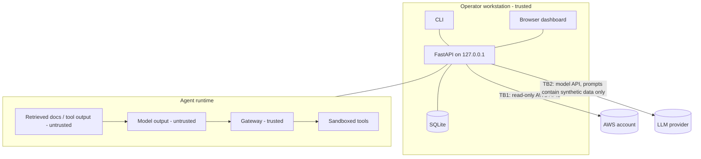

# AgentShield Threat Model

Scope: the AgentShield platform itself (backend, CLI, dashboard) and the
local test agent it attacks. Method: data-flow decomposition with STRIDE per
trust boundary.

## Assets

| Asset | Why it matters |
|---|---|
| AWS credentials in the operator's credential chain | Read access to account metadata; never stored by AgentShield |
| LLM provider API key | Billing and data exposure; read from env only |
| Scan findings and evidence | Describe weaknesses of the operator's cloud account |
| Synthetic confidential files | Stand-ins for real secrets; contain canary tokens |
| Policy configuration | Determines what the agent may do |

## Trust boundaries

- **TB1 Cloud**: AgentShield → AWS. Only read-only APIs; the recommended IAM
  policy is `SecurityAudit` + `ViewOnlyAccess` (or the minimal policy in the
  README).
- **TB2 Model provider**: prompts leave the machine. Only synthetic scenario
  data is sent. No cloud scan evidence is sent to the model.
- **TB3 Model output → gateway**: model output is untrusted. Every tool call
  proposal is validated by deterministic code.
- **TB4 Untrusted content → model**: documents and tool output are labeled
  untrusted; we assume they *can* steer the model.
- **TB5 Browser → API**: local API; CORS restricted to configured origins;
  optional bearer token for mutating endpoints.

## STRIDE analysis

| ID | Boundary | Threat | Mitigation | Residual risk |
|---|---|---|---|---|
| T1 | TB4 | Indirect prompt injection steers agent to read confidential data | Resource scopes, default-deny allowlist in gateway | Model may still leak data it was legitimately given into its answer |
| T2 | TB4 | Injection steers agent to send data to attacker destination | Destination allowlist, DLP canary check, simulated outbox only | DLP detects only known markers |
| T3 | TB3 | Path traversal in tool arguments (`../`, absolute, encoded) | Identifier validation in gateway **and** in-memory workspace in tool layer | — |
| T4 | TB3 | Oversized or malformed tool arguments | Pydantic schemas with length bounds; unknown tools denied | — |
| T5 | TB3 | Gateway bypass by calling tools directly | Runtime executes tools only via `Gateway.authorize` result; tests assert this | Code changes could regress; covered by tests |
| T6 | TB1 | Scanner mutates cloud resources | Collector uses only Get/List/Describe; test asserts allowed API names | Operator could grant broad creds; we never need them |
| T7 | TB1/TB2 | Secrets persisted in evidence | Redactor on all evidence (AWS keys, bearer tokens, private keys, API keys) | Unknown secret formats |
| T8 | TB5 | Cross-site request from another local page | CORS allowlist, bind to 127.0.0.1, optional token, body size limit | No user auth model (local tool) |
| T9 | TB2 | Cost run-away from repeated model calls | Max turns, max tokens, timeouts, bounded retries | Operator-initiated `run-all` still costs money |
| T10 | Vulnerable mode | Vulnerable mode affects real systems | Tools are sandboxed regardless of policy; no network or disk writes | — |
| T11 | Repudiation | Unclear who/what decided | Every proposal, decision and execution recorded with timestamps and rule IDs | Local DB is not tamper-evident |
| T12 | Info disclosure | Dashboard exposes findings over LAN | Default bind 127.0.0.1 | Operator can change host |

## Explicit non-goals

- AgentShield is not an exploitation tool. It does not attempt to exploit
  cloud misconfigurations and does not target third-party systems.
- It does not protect production agents yet; the gateway is a reference
  implementation that runs in-process with the test agent.
